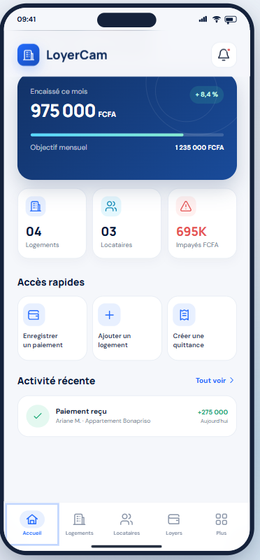
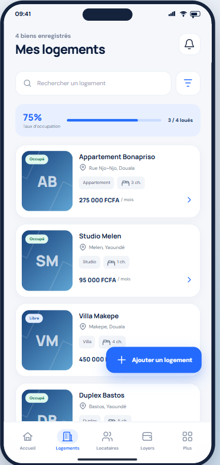
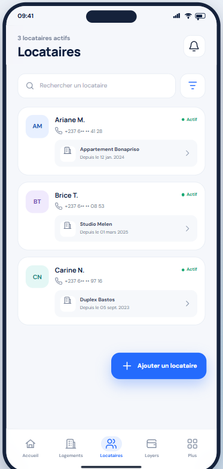
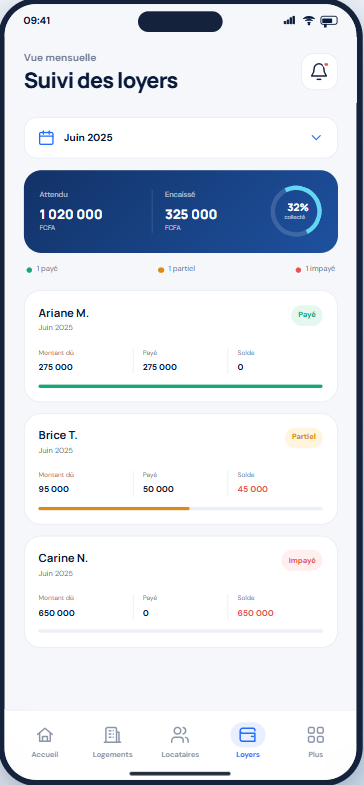
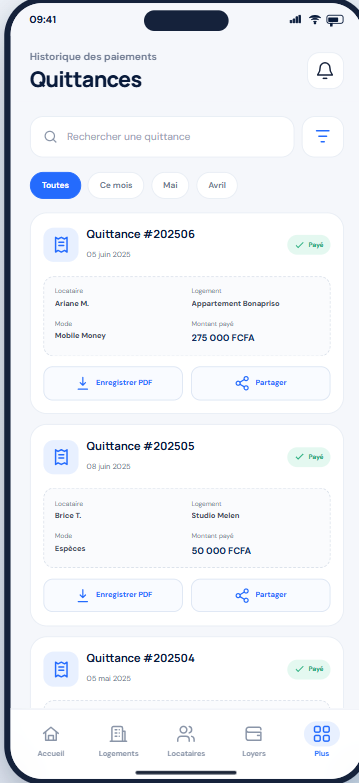

# LoyerCam

**Application de gestion locative | Rental Management Application**

[Français](#-français) · [English](#-english)

---

## 🇫🇷 Français

### Présentation

**LoyerCam** est une application de gestion locative développée avec C# et .NET MAUI. Elle a pour objectif de faciliter le suivi des logements, des locataires et des paiements de loyers au sein d'une interface unique.

### Fonctionnalités

- **Tableau de bord** : aperçu des informations essentielles de gestion.
- **Gestion des logements** : suivi des logements enregistrés.
- **Gestion des locataires** : consultation et gestion des informations des locataires.
- **Suivi des loyers** : gestion des loyers et des paiements.
- **Suivi des impayés** : identification des loyers impayés.
- **Quittances de loyer** : génération de quittances au format PDF.

### Technologies utilisées

- **C#** — langage de programmation.
- **.NET MAUI** — développement de l'interface multiplateforme.
- **XAML** — définition des interfaces utilisateur.
- **SQLite** — stockage local des données.
- **QuestPDF** — génération de documents PDF.

### Prérequis

Pour ouvrir et exécuter le projet sous Windows, il est recommandé de disposer de :

- Windows avec un environnement compatible.
- Visual Studio 2026 avec la charge de travail **Développement de l'interface utilisateur d'application multiplateforme .NET (MAUI)**.
- Le SDK .NET requis par le fichier projet.
- Les composants de développement correspondant à la plateforme cible.

### Installation

1. Cloner le dépôt :

   ```bash
   git clone https://github.com/hioltherese7-dev/LoyerCam.git
   ```

2. Ouvrir le dossier du projet dans Visual Studio.
3. Ouvrir la solution `Loyercam.slnx`.
4. Restaurer les dépendances NuGet si nécessaire.
5. Sélectionner une plateforme compatible et lancer l'application.

### Structure du projet

- `Pages/` : pages et interfaces de l'application.
- `Models/` : modèles de données.
- `Services/` : services applicatifs.
- `Resources/` : ressources graphiques, polices et styles.
- `Platforms/` : éléments spécifiques aux plateformes prises en charge.
- `BaseDeDonnees.cs` : accès à la base de données locale.

### Maquettes et captures d'écran

Les maquettes de conception et les captures d'écran de l'application seront ajoutées dans le dossier `Documentation/`.

### État du projet

Le dépôt contient le code source de LoyerCam. Les fonctionnalités disponibles peuvent être vérifiées en exécutant l'application.

---

## 🇬🇧 English

### Overview

**LoyerCam** is a rental management application developed with C# and .NET MAUI. Its goal is to simplify the management of properties, tenants, and rent payments through a single interface.

### Features

- **Dashboard**: overview of essential rental management information.
- **Property management**: manage registered rental properties.
- **Tenant management**: view and manage tenant information.
- **Rent tracking**: manage rents and payment records.
- **Unpaid rent tracking**: identify unpaid rent.
- **Rent receipts**: generate PDF rent receipts.

### Technologies

- **C#** — programming language.
- **.NET MAUI** — cross-platform application framework.
- **XAML** — user interface definition.
- **SQLite** — local data storage.
- **QuestPDF** — PDF document generation.

### Requirements

To open and run the project on Windows, the following environment is recommended:

- Windows with a compatible development environment.
- Visual Studio 2026 with the **.NET Multi-platform App UI development** workload.
- The .NET SDK required by the project file.
- The development components for the selected target platform.

### Installation

1. Clone the repository:

   ```bash
   git clone https://github.com/hioltherese7-dev/LoyerCam.git
   ```

2. Open the project folder in Visual Studio.
3. Open the `Loyercam.slnx` solution.
4. Restore NuGet dependencies if needed.
5. Select a supported target platform and run the application.

### Project structure

- `Pages/`: application pages and user interfaces.
- `Models/`: data models.
- `Services/`: application services.
- `Resources/`: graphics, fonts, and styles.
- `Platforms/`: platform-specific files.
- `BaseDeDonnees.cs`: local database access.

### Design mockups and screenshots

Design mockups and application screenshots will be added to the `Documentation/` directory.

### Project status

The repository contains the LoyerCam source code. Available features can be verified by building and running the application.

---

## Repository

GitHub: https://github.com/hioltherese7-dev/LoyerCam

**LoyerCam — Rental management made simpler.**

## 🎨 Maquettes de l’application

### Français

Consultez les maquettes et le prototype interactif de LoyerCam sur Figma.

👉 [Ouvrir les maquettes Figma de LoyerCam](https://www.figma.com/make/4tMbUXsrsKLvhnhTtHikrm/LoyerCam-application-mobile?fullscreen=1&t=V1pFmTS4UwX5jyxZ-1&code-node-id=0-6)

### English

Explore the LoyerCam application mockups and interactive prototype on Figma.

👉 [Open LoyerCam Figma mockups](https://www.figma.com/make/4tMbUXsrsKLvhnhTtHikrm/LoyerCam-application-mobile?fullscreen=1&t=V1pFmTS4UwX5jyxZ-1&code-node-id=0-6)

## 🖼️ Aperçu des maquettes / UI Mockups

### 🇫🇷 Français

Voici un aperçu des principales interfaces conçues pour LoyerCam avec Figma. Ces images représentent les maquettes de conception de l'application.

#### Accueil


#### Gestion des logements


#### Gestion des locataires


#### Suivi des loyers


#### Gestion des impayés


#### Quittances


### 🇬🇧 English

Here is a preview of the main LoyerCam interfaces designed with Figma. These images represent the application's design mockups.
